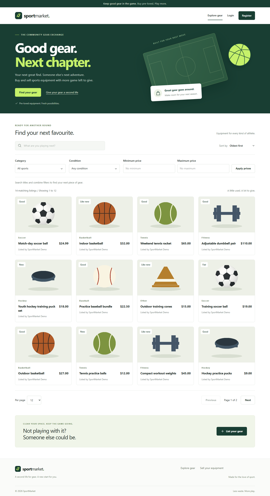
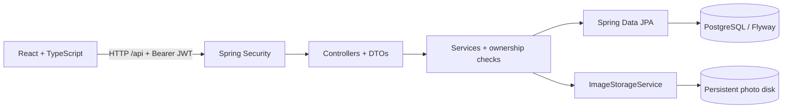

# SportMarket

A full-stack marketplace that gives sports equipment a second life. Browse and filter gear, create an account, and manage listings with product photos and backend ownership checks.

**React | TypeScript | Java 21 | Spring Boot 4.1.2 | PostgreSQL**



Screenshots use an isolated demo database and original equipment illustrations, with no real accounts or private listings. Run the application locally using the instructions below.

## Features

- Title search, category/condition/price filters, sorting, and server-side pagination. Filters stay in the URL.
- Registration and JWT login. Tokens live only in React memory and are cleared on logout or expiry.
- Listing creation, editing, deletion, and sold status, protected by backend ownership checks.
- Up to five validated JPEG, PNG, or WebP photos per listing, selection previews, and a gallery.
- Responsive layouts and helpful loading, empty, validation, and error states.

[Listing details](docs/screenshots/listing-details.png) | [Owner dashboard](docs/screenshots/my-listings.png) | [Mobile](docs/screenshots/mobile.png)

## Architecture



| Directory | Purpose |
| --- | --- |
| [`frontend/`](frontend/README.md) | React Router pages, reusable components, auth context, typed API client, tests |
| [`sportmarket/`](sportmarket/README.md) | Spring Boot controllers, services, repositories, entities, DTOs, security, Flyway migrations, tests |
| [`scripts/`](scripts/) | Optional fictional demo catalogue and screenshot tooling |
| [`deploy/`](deploy/) | Container startup and PostgreSQL-to-JDBC URL conversion |
| [`.github/workflows/ci.yml`](.github/workflows/ci.yml) | Tests, frontend build, and container build |

## Run locally

Requires Java 21, Maven, PostgreSQL, Node.js 24 LTS, and npm. Follow the [backend database setup](sportmarket/README.md#local-postgresql-setup) to create PostgreSQL and set `DB_USERNAME`, `DB_PASSWORD`, and a random Base64 `JWT_SECRET` in the backend terminal. Spring Boot does not automatically load `.env` files.

From the workspace root, in that terminal:

```powershell
cd sportmarket
mvn spring-boot:run
```

In a second terminal, from the workspace root:

```powershell
cd frontend
npm.cmd ci
npm.cmd run dev
```

Open http://localhost:5173. Vite proxies `/api` to http://localhost:8080. See [frontend configuration](frontend/README.md#configuration-and-api-integration) for `VITE_API_URL` and `API_PROXY_TARGET`. Refreshing the page signs you out because tokens are kept only in memory.

### Use Neon instead of local PostgreSQL

The optional root Neon configuration declares PostgreSQL only; existing Spring Security/JWT authentication and local image storage are preserved.

From the workspace root, after linking your own Neon project with `neon init`:

```powershell
npm.cmd ci
neon deploy
npm.cmd run backend:neon
```

Neon writes secrets to ignored `.env.local` (or `.env` if it exists). The backend launcher reads that file and converts the pooled `DATABASE_URL` to JDBC credentials. Flyway uses `DATABASE_URL_UNPOOLED` through a separate direct connection. The PostgreSQL JDBC driver and JPA remain in use; the browser never receives database credentials. The `neon` profile uses a small Hikari pool with zero minimum idle connections.

In a second terminal, run `npm.cmd run dev` from the root and open http://localhost:5173. Root `npm.cmd run build` builds the frontend. The launcher generates a temporary JWT signing key unless you set `JWT_SECRET` securely; restarting with a new key invalidates existing tokens.

This connects the backend to Neon; `neon deploy` does not host the Spring Boot application or React frontend. Uploaded photo bytes still live in the configured local directory. A Cloud Run deployment needs persistent image storage configured separately.

For an isolated real-database verification, create a disposable branch named `sportmarket-neon-verification`, pull its environment to `.env.neon-verification`, build the backend with `mvn package`, then run `node scripts/verify-neon.mjs .env.neon-verification`. The check creates fictional accounts/listings, tests ownership and CRUD, restarts the backend to prove persistence, and deletes its listing. It refuses write tests on other branches. `--read-only` skips API mutations but application startup still applies pending Flyway migrations.

### Cloud Run

From a fresh checkout in Google Cloud Shell, run `bash deploy/cloud-run.sh YOUR_PROJECT_ID`. This creates a public SportMarket web service, a private Cloud Storage photo bucket, and a Secret Manager configuration. Google Cloud usage charges may apply; it does not create Cloud SQL.

The script prompts privately for Neon connection strings with pooling on and off if no local Neon env file exists. It builds the root Dockerfile, enables the `production,neon` profiles, and prints the service URL after checking the homepage and categories API. Existing JWT signing keys are preserved on redeploy. Keep credentials out of chat, shell command arguments, and Git.

Cloud configuration tests run with `npm.cmd run test:neon-config`. Actual Google Cloud permissions, image startup, photo uploads, and persistence must be verified after deploying; local tests cannot verify the live cloud environment. The storage mount uses Cloud Storage FUSE, which has different filesystem semantics from a local disk; test upload/delete and photo survival across redeploys before sharing the demo.

## Try the complete flow

1. Browse gear, combine filters, and open a listing's gallery.
2. Register with a test email and your own password, then log in.
3. Create a listing and choose photos. Creation and uploads use separate requests; partial failures explain what was saved and support retrying.
4. Open **My listings**, edit, mark sold, and confirm a deletion.
5. Use a second account to verify that another seller's listings cannot be changed. Backend APIs return 403 for non-owners.

Use fictional information on a public demo. There is no shared demo password. Complete browser and Postman workflows are in the [frontend](frontend/README.md) and [backend](sportmarket/README.md) guides.

## Tests

```powershell
# From sportmarket/: uses test-only H2, not your local PostgreSQL database
mvn test

# From frontend/
npm.cmd test
npm.cmd run build

# Optional Python 3 demo-tool checks, from the workspace root
python -m unittest discover -s scripts -p 'test_*.py'
```

Verified locally: **89 backend tests, 31 frontend tests, 5 deployment/demo-tool tests, and 3 Neon configuration tests pass**. The frontend production build passes. Live Neon verification also covers Flyway V1-V4, registration/login, CRUD, ownership, and persistence across backend restarts on an isolated branch; public reads are smoke-tested on the linked production branch. CI also builds the deployment container; local container builds need Docker Desktop running.

## Engineering decisions and limits

- **Authorization:** services compare persisted seller IDs with the validated JWT subject, never a seller ID supplied by the browser.
- **Images:** content is decoded, checked for dimensions/size/corruption, and re-encoded. Server-generated filenames and controlled paths prevent arbitrary filesystem access.
- **Persistence:** Flyway owns the schema; Hibernate validates it. Transaction-aware cleanup coordinates database metadata and photo files.
- **Queries:** filtering and pagination run in the database, sorting is allowlisted, and result-page image metadata is fetched in batches.
- **Authentication tradeoff:** memory-only tokens avoid persistent browser storage, but refresh requires login. Refresh tokens and password reset are not implemented.
- **Storage tradeoff:** a persistent local disk suits a single-instance demo. Multiple instances would require shared/object storage. Thumbnails are not generated yet.
- **Scope:** no payments, messaging, cloud image storage, or admin roles. This is a portfolio application, not a production commerce service.

## Portfolio

The [GitHub checklist](docs/PORTFOLIO.md) covers repository presentation, screenshots, and pinning the project. Local database contents and existing uploaded photos are not included in source control.
