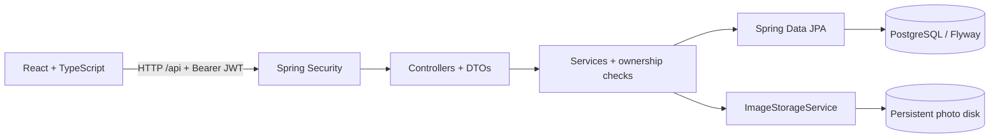

# SportMarket

A full-stack marketplace that gives sports equipment a second life. Browse and filter gear, create an account, and manage listings with product photos and backend ownership checks.

**React · TypeScript · Java 21 · Spring Boot 4.1.2 · PostgreSQL**


Screenshots use an isolated demo database and original equipment illustrations, with no real accounts or private listings. Deployment configuration is prepared; a live URL will be added after publishing.

## Features

- Title search, category/condition/price filters, sorting, and server-side pagination. Filters stay in the URL.
- Registration and JWT login. Tokens live only in React memory and are cleared on logout or expiry.
- Listing creation, editing, deletion, and sold status, protected by backend ownership checks.
- Up to five validated JPEG, PNG, or WebP photos per listing, selection previews, and a gallery.
- Responsive layouts and helpful loading, empty, validation, and error states.

[Listing details](docs/screenshots/listing-details.png) · [Owner dashboard](docs/screenshots/my-listings.png) · [Mobile](docs/screenshots/mobile.png)

## Architecture



| Directory | Purpose |
| --- | --- |
| [`frontend/`](frontend/README.md) | React Router pages, reusable components, auth context, typed API client, tests |
| [`sportmarket/`](sportmarket/README.md) | Spring Boot controllers, services, repositories, entities, DTOs, security, Flyway migrations, tests |
| [`scripts/`](scripts/) | Optional fictional demo catalogue and screenshot tooling |
| [`deploy/`](deploy/) | Container startup and PostgreSQL-to-JDBC URL conversion |
| [`.github/workflows/ci.yml`](.github/workflows/ci.yml) | Tests, frontend build, and container build |

## Run locally

Requires Java 21, Maven, PostgreSQL, Node.js 24 LTS, and npm. Follow the [backend database setup](sportmarket/README.md#local-postgresql-setup) to create PostgreSQL and set `DB_USERNAME`, `DB_PASSWORD`, and a random Base64 `JWT_SECRET` in the backend terminal. Spring Boot does not automatically load `.env` files.

From the workspace root, in that terminal:

```powershell
cd sportmarket
mvn spring-boot:run
```

In a second terminal, from the workspace root:

```powershell
cd frontend
npm.cmd ci
npm.cmd run dev
```

Open http://localhost:5173. Vite proxies `/api` to http://localhost:8080. See [frontend configuration](frontend/README.md#configuration-and-api-integration) for `VITE_API_URL` and `API_PROXY_TARGET`. Refreshing the page signs you out because tokens are kept only in memory.

## Try the complete flow

1. Browse gear, combine filters, and open a listing's gallery.
2. Register with a test email and your own password, then log in.
3. Create a listing and choose photos. Creation and uploads use separate requests; partial failures explain what was saved and support retrying.
4. Open **My listings**, edit, mark sold, and confirm a deletion.
5. Use a second account to verify that another seller's listings cannot be changed. Backend APIs return 403 for non-owners.

Use fictional information on a public demo. There is no shared demo password. Complete browser and Postman workflows are in the [frontend](frontend/README.md) and [backend](sportmarket/README.md) guides.

## Tests

```powershell
# From sportmarket/: uses test-only H2, not your local PostgreSQL database
mvn test

# From frontend/
npm.cmd test
npm.cmd run build

# Optional Python 3 demo-tool checks, from the workspace root
python -m unittest discover -s scripts -p 'test_*.py'
```

Verified locally: **89 backend tests, 31 frontend tests, and 5 deployment/demo-tool tests pass**. The frontend production build passes. Screenshots exercise the built frontend with a real isolated Spring Boot backend. H2 tests do not replace a PostgreSQL deployment smoke test. CI also builds the deployment container; local container builds need Docker Desktop running.

## Engineering decisions and limits

- **Authorization:** services compare persisted seller IDs with the validated JWT subject, never a seller ID supplied by the browser.
- **Images:** content is decoded, checked for dimensions/size/corruption, and re-encoded. Server-generated filenames and controlled paths prevent arbitrary filesystem access.
- **Persistence:** Flyway owns the schema; Hibernate validates it. Transaction-aware cleanup coordinates database metadata and photo files.
- **Queries:** filtering and pagination run in the database, sorting is allowlisted, and result-page image metadata is fetched in batches.
- **Authentication tradeoff:** memory-only tokens avoid persistent browser storage, but refresh requires login. Refresh tokens and password reset are not implemented.
- **Storage tradeoff:** a persistent local disk suits a single-instance demo. Multiple instances would require shared/object storage. Thumbnails are not generated yet.
- **Scope:** no payments, messaging, cloud image storage, or admin roles. This is a portfolio application, not a production commerce service.

## Deployment and portfolio

The [deployment guide](docs/DEPLOYMENT.md) covers Docker, Render, estimated costs, persistent storage, fictional demo data, and smoke tests. The [GitHub checklist](docs/PORTFOLIO.md) covers repository creation, pinning, and adding the verified live URL. Local database contents and existing uploaded photos are not included in source control.
